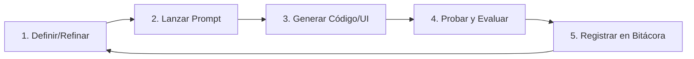

# 🧠 Entorno de Definición Iterativa con IA

Bienvenido al espacio de trabajo para la concepción, diseño y construcción del sitio web mediante un **proceso iterativo asistido por Inteligencia Artificial**.

---

## 🎯 Objetivo del Entorno

Separar con claridad:
1. **Aspectos Técnicos:** Cómo se construye la herramienta (tecnologías, arquitectura, diseño visual, estándares).
2. **Aspectos Funcionales:** Qué hace y para quién es el sitio (visión, mapa del sitio, historias de usuario, contenidos).
3. **Ciclos de Iteración:** Registro continuo de avances, prompts y refinamientos progresivos.

---

## 📁 Estructura del Proyecto

```text
.
├── .gitignore
├── README.md                          # Este documento (guía general)
└── prompts/
    ├── README.md                      # Metodología y cómo usar los prompts
    ├── prompt_maestro_sistema.md      # Plantilla de contexto maestro para la IA
    │
    ├── tecnicos/                      # CÓMO SE CONSTRUYE
    │   ├── 01_stack_tecnologico.md    # Lenguajes, frameworks, librerías, dependencias
    │   ├── 02_arquitectura_y_carpetas.md # Estructura del código y modularidad
    │   ├── 03_diseno_y_ui_ux.md       # Sistema de diseño, paleta, tipografía, microinteracciones
    │   └── 04_estandares_y_reglas.md  # Calidad, a11y, SEO técnico y convenciones
    │
    ├── funcionales/                   # QUÉ HACE Y PARA QUIÉN
    │   ├── 01_vision_y_audiencia.md   # Propósito, propuesta de valor y público objetivo
    │   ├── 02_mapa_del_sitio_y_flujos.md # Páginas, navegación y recorridos de usuario
    │   ├── 03_funcionalidades_y_historias.md # Módulos, requisitos e historias de usuario
    │   └── 04_contenido_y_copy.md     # Tono, mensajes clave, llamadas a la acción y assets
    │
    └── iteraciones/                   # HISTORIAL Y PLAN DE ACCIÓN
        ├── plantilla_iteracion.md     # Formato para lanzar una nueva iteración
        └── bitacora_iteraciones.md    # Registro de ciclos, decisiones y aprendizajes
```

---

## 🔄 El Ciclo de Iteración (Paso a Paso)



1. **Definir / Refinar:** Ajusta los archivos en `prompts/funcionales/` y `prompts/tecnicos/`.
2. **Lanzar Prompt:** Usa `prompts/iteraciones/plantilla_iteracion.md` para indicarle a la IA qué construir o ajustar.
3. **Generar Código:** La IA genera o modifica la implementación basándose en las especificaciones.
4. **Probar y Evaluar:** Valida visual y funcionalmente el resultado.
5. **Registrar:** Anota en `bitacora_iteraciones.md` los cambios, qué funcionó y qué se debe ajustar en el siguiente ciclo.

---

## 🚀 Próximos Pasos Recomendados

1. **Paso 1:** Abre `prompts/funcionales/01_vision_y_audiencia.md` y define la idea base del sitio web (o conversa con la IA para definirlo).
2. **Paso 2:** Revisa `prompts/tecnicos/01_stack_tecnologico.md` para acordar la tecnología base (HTML/CSS/JS nativo, Vite, React, etc.).
3. **Paso 3:** Lanza la **Iteración 01** creando el wireframe o primera versión funcional.
