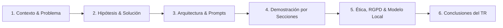

# 🎓 Estructura de la Presentación: Anaxagoras AI
### *Defensa y Exposición práctica del Treball de Recerca (TR): "La IA en els estudis"*

Este borrador articula la presentación de la aplicación **Anaxagoras AI** como la **demostración empírica y prototipo funcional** de la hipótesis defendida en tu Treball de Recerca (TR). Cada bloque vincula directamente las características de la aplicación con los capítulos y conceptos de tu memoria escrita.

---

## 📑 Índice de la Presentación

---

## 🖥️ Estructura Diapositiva por Diapositiva con Anotaciones al TR

### Diapositiva 1: Portada & Título
* **Título:** Anaxagoras AI: Prototipo de Tutor Socrático Inteligente para el Ámbito Escolar.
* **Subtítulo:** De la teoría a la práctica: Implementación de un modelo institucional regulado y adaptativo.
* **Elemento visual:** Logotipo del **Búho del Nous** (fusión del búho de Atenea, redes neuronales y la chispa socrática).
* **Anotación al TR:** 
  > *Conexión con TR §1.1 & §1.2:* Introduce tu punto de partida como estudiante de 2n de Batxillerat y la necesidad de pasar del uso caótico de la IA a una plataforma institucional tutelada.

---

### Diapositiva 2: El Diagnóstico: La IA a las Aulas Hoy
* **Mensaje clave:** Los estudiantes ya usamos IA, pero el modelo comercial actual perjudica el aprendizaje.
* **Puntos a exponer:**
  1. **Uso desregulado y solitario:** Acceso a ChatGPT o Claude desde casa sin filtro didáctico.
  2. **La ley del mínimo esfuerzo:** La IA genérica busca complacer rápido; da la respuesta final y hace los deberes por el alumno.
  3. **Efecto GPS y atrofia cognitiva:** Pérdida de tolerancia a la frustración y de razonamiento crítico.
  4. **Alucinaciones y sesgos:** Un alumno joven no distingue un error inventado por el LLM de una verdad empírica.
* **Anotación al TR:** 
  > *Conexión con TR §2.1, §3.2, §3.4:* Cita expresamente el "efecto GPS" y los riesgos de alucinación y debilitamiento del pensamiento crítico detallados en tu capítulo 3.

---

### Diapositiva 3: La Hipótesis Central del Treball de Recerca
* **Mensaje clave:** La transición de un modelo abierto a un **Sistema Institucionalizado**.
* **El triángulo pedagógico:**
  * No un intercambio binario pantalla-alumno, sino una **relación triangular**: *Alumno ↔ IA ↔ Directrices del Centro / Departament d'Educació*.
* **Las dos fuentes que se cruzan en tiempo real:**
  1. **Expediente del estudiante:** Edad, curso (1r ESO vs 2n Batxillerat) y posibles NESE (TDAH, dislexia) vía plataformas como *Esfer@*.
  2. **Normativas del centro (*System Prompts*):** Metodología fijada por los departamentos docentes que la IA no puede desobedecer.
* **Anotación al TR:** 
  > *Conexión con TR §1.2 (Hipótesis) y §1.3 (Objetivos):* Aquí justificas ante el tribunal por qué has construido Anaxagoras AI: para poner a prueba empíricamente si este cruce de datos funciona en la práctica.

---

### Diapositiva 4: Arquitectura del Sistema: *System Prompts* vs *User Prompts*
* **Mensaje clave:** El control pedagógico reside en la capa oculta de instrucciones.
* **Explicación técnica simplificada:**
  * **User Prompt:** Lo que escribe el estudiante (p. ej.: *"Dime la solución a esta ecuación"*).
  * **System Prompt:** Reglas inmutables preconfiguradas en el sistema (p. ej.: *"Aplica el método socrático; jamás des el resultado final"*).
* **Innovación en Anaxagoras AI:**
  * Los prompts no están escondidos en código opaco ni se improvisan: **son ficheros Markdown estáticos auditables** en el repositorio (`src/prompts/`), accesibles desde la propia aplicación para profesores y alumnos.
* **Anotación al TR:** 
  > *Conexión con TR §2.2 & §2.3:* Tu trabajo define el *Prompt Engineering* no como un truco de usuario, sino como la base de la ingeniería de software pedagógico.

---

### Diapositiva 5: Sección 1 - Agenda Inteligente & Gestión del Tiempo
* **Función en la App:** Organización del horario semanal, tareas y bloques de estudio.
* **Flujo con IA:** Botón *"🤖 Planificar con IA"*.
* **Fundamento pedagógico:**
  * Genera bloques basados en **estudio espaciado** y técnica Pomodoro adaptada.
  * Sincronización real con **Google Calendar** y preparado para vincularse al calendario escolar institucional.
  * Reduce la sobrecarga cognitiva y la ansiedad por exámenes acumulados.
* **Anotación al TR:** 
  > *Conexión con TR §2.4 & §3.1:* Representa la conexión del asistente con las tareas escolares del alumno para estructurar su rutina antes de la sesión de estudio.

---

### Diapositiva 6: Sección 2 - Estudio y Repaso: El Tutor Socrático
* **Función en la App:** Asistente interactivo de resolución de dudas y generador de tarjetas de **Active Recall** (recuperación activa).
* **Los Guardrails (Barreras de Contención) en acción:**
  * El tutor tiene **prohibido dar la respuesta final**.
  * Si el alumno pide la solución, responde con una pregunta guía que activa el razonamiento.
* **Adaptación Cognitiva según la teoría de Piaget:**
  * **Alumne de 1r d'ESO (12 años - Operaciones Concretas / Transición):** Instrucciones paso a paso, oraciones cortas, metáforas del mundo real y videojuegos, refuerzo positivo empático.
  * **Alumne de 2n de Batxillerat (17-18 años - Operaciones Formales):** Pensamiento hipotético-deductivo, vocabulario técnico-formal preuniversitario, eliminación de metáforas infantiles.
* **Anotación al TR:** 
  > *Conexión con TR §4.1 (Piaget e Inhelder), §4.2 (Adaptación de lenguaje y estilo) y §4.3 (Guardrails):* Es el núcleo experimental de tu investigación. Aquí demuestras cómo la teoría del desarrollo cognitivo se convierte en parámetros directos de un LLM.

---

### Diapositiva 7: Sección 3 - Trabajos Escolares: Guía de 4 Fases
* **Función en la App:** Acompañamiento en la redacción de proyectos y trabajos de curso (como el propio TR).
* **Estructura en 4 Fases Metodológicas:**
  1. *Fase 1: Investigación & Pregunta Guía.*
  2. *Fase 2: Estructura & Índice temático.*
  3. *Fase 3: Redacción del Borrador (con feedback formativo).*
  4. *Fase 4: Revisión crítica y citación de fuentes.*
* **Barrera anti-plagio:**
  * La IA no redacta el trabajo; audita la coherencia de las secciones y señala dónde faltan argumentos o fuentes primarias.
* **Anotación al TR:** 
  > *Conexión con TR §3.4 (Mitigación de la pérdida de pensamiento crítico) y §4.3 (Guardrail de lenguas y redacción):* El sistema actúa como un evaluador formativo, garantizando que el autor intelectual sea 100% el estudiante.

---

### Diapositiva 8: Ética, Privacitat i el RGPD: Modelo Local vs Cloud
* **Mensaje clave:** Cómo resolver el gran dilema legal planteado en el TR.
* **El dilema del TR (§5.2 & §5.3):**
  * Los datos de salud o NESE (TDAH, dislexia) son datos de categoría especial.
  * Enviar datos de menores a servidores extranjeros (OpenAI, Google en EE.UU.) vulnera el RGPD.
  * Si las familias hacen *opt-out*, ¿se crea una "escuela a dos velocidades"?
* **La Solución Técnica de Anaxagoras AI:**
  * **Soporte de Modelo Local (Ollama en el propio centro / equipo):** Inferencia local y privada sin enviar datos fuera de la red escolar. Soberanía total de datos.
  * **Conexión Cloud Opcional con anonimización:** Para centros que cuenten con acuerdos institucionales de nube privada.
  * **Modo Demo / Offline:** Funciona incluso sin conexión gracias a la arquitectura PWA.
* **Anotación al TR:** 
  > *Conexión con TR §5.2 (RGPD), §5.3 (Dilema Privacidad vs Equidad) y §5.4 (Viabilidad tecnológica con modelos Open-Source).*

---

### Diapositiva 9: Integración en el Contexto de Cataluña (Pla d'Educació Digital)
* **Mensaje clave:** El hardware ya está en las aulas; Anaxagoras AI aporta la inteligencia pedagógica.
* **Puntos clave:**
  * El **Pla d'Educació Digital de Catalunya (PEDC)** ya dotó a los institutos de ordenadores portátiles y conectividad.
  * **PWA (Progressive Web App):** Instalable en cualquier portátil escolar (Chromebook, Windows, Linux) sin requerir instalación por administradores de sistemas.
  * **Multi-idioma Estándar (i18n):** Interfaz completa en **Català** (lengua vehicular de la educación en Cataluña), Castellano, Galego, Euskera y Valencià.
* **Anotación al TR:** 
  > *Conexión con TR §5.1 (PEDC) y §5.4 (Conclusión de viabilidad):* Justifica que la administración no necesita gastar millones en nuevos equipos, sino implementar este tipo de capas de software.

---

### Diapositiva 10: Conclusiones del Treball de Recerca
* **Conclusiones respaldadas por el software:**
  1. **La viabilidad técnica es real:** No es una utopía de ciencia ficción; un LLM guiado por *System Prompts* estáticos puede adaptarse al nivel cognitivo de 1r de ESO o 2n de Batxillerat.
  2. **El profesor sigue siendo insustituible:** La IA no reemplaza al docente; asume el rol de tutor socrático complementario y libera al profesor de tareas repetitivas para centrarse en intervenciones pedagógicas de alto valor.
  3. **La regulación institucional es urgente:** Si la escuela no lidera la adopción de herramientas cerradas con guardrails, los alumnos seguirán usando IAs comerciales sin control ni pedagogía.
* **Anotación al TR:** 
  > *Conexión con TR §5.4 & §6 (Conclusions finals):* Cierre con impacto, ligando el rigor académico de tu texto con la aplicación que has construido.

---

## 📊 Matriz de Correspondencias: Tu Documento vs Anaxagoras AI

| Apartado de tu TR | Concepto Teórico en el Documento | Elemento Implementado en Anaxagoras AI | Fichero de Código Relevante |
| :--- | :--- | :--- | :--- |
| **§1.2 / §2.3** | *System Prompts* vs *User Prompts* | Prompts del sistema desacoplados en ficheros Markdown estáticos con visor in-app | [src/prompts/](file:///c:/Users/alvar/git/anaxagoras-ia-tr/src/prompts/) / [prompt-viewer-modal.ts](file:///c:/Users/alvar/git/anaxagoras-ia-tr/src/components/modals/prompt-viewer-modal.ts) |
| **§2.4** | Integración con bases de datos escolares (Esfer@) | Conectores de cuenta escolar con Google Calendar y Drive + perfil de usuario | [google-calendar.ts](file:///c:/Users/alvar/git/anaxagoras-ia-tr/src/services/google-calendar.ts) / [google-drive.ts](file:///c:/Users/alvar/git/anaxagoras-ia-tr/src/services/google-drive.ts) |
| **§3.1** | Aprendizaje adaptativo y personalización masiva | Generador de planes de estudio y Active Recall dinámico | [agenda-view.ts](file:///c:/Users/alvar/git/anaxagoras-ia-tr/src/components/views/agenda-view.ts) / [study-view.ts](file:///c:/Users/alvar/git/anaxagoras-ia-tr/src/components/views/study-view.ts) |
| **§4.1 / §4.2** | Estadios de Piaget (1r ESO vs 2n Batxillerat) | Instrucciones de nivel de abstracción y vocabulario en el prompt del tutor | [socratic_tutor.md](file:///c:/Users/alvar/git/anaxagoras-ia-tr/src/prompts/socratic_tutor.md) |
| **§4.3** | *Guardrails* y Método Socrático | Prohibición absoluta de dar resultados directos; guía por preguntas reflexivas | [socratic_tutor.md](file:///c:/Users/alvar/git/anaxagoras-ia-tr/src/prompts/socratic_tutor.md) / [project_guide.md](file:///c:/Users/alvar/git/anaxagoras-ia-tr/src/prompts/project_guide.md) |
| **§5.1** | Pla d'Educació Digital de Catalunya | PWA ligera y rápida, adaptable a cualquier pantalla escolar | [manifest.webmanifest](file:///c:/Users/alvar/git/anaxagoras-ia-tr/public/manifest.webmanifest) / [sw.js](file:///c:/Users/alvar/git/anaxagoras-ia-tr/public/sw.js) |
| **§5.2** | RGPD, soberanía de datos y servidores locales | Integración dual con modelo Local (Ollama) para no enviar datos a terceros | [ai-client.ts](file:///c:/Users/alvar/git/anaxagoras-ia-tr/src/services/ai-client.ts) |

---

## 💡 Consejos Clave para la Defensa Oral del TR
1. **Destaca la transparencia:** Muestra en directo el modal de *"Ver Prompt"* de la aplicación. Pocos proyectos de TR enseñan las entrañas de la IA; demostrar que las reglas pedagógicas son legibles en Markdown generará una excelente impresión en el tribunal.
2. **Haz hincapié en el dilema ético:** El tribunal valorará muy positivamente que no vendas la IA como una solución milagrosa, sino que abordes el conflicto del RGPD y expliques por qué un modelo **Local (Ollama)** es la solución que protege a los menores en Cataluña.
3. **El rol del docente:** Reitera que la herramienta no busca sustituir a los profesores de secundaria, sino darles soporte para que las horas de clase se dediquen a debates y apoyo humano de alto nivel.
